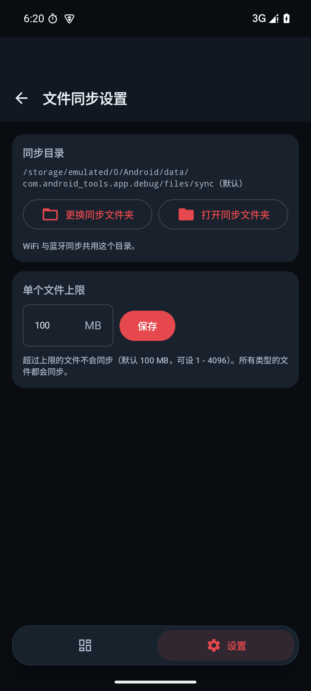

# android-tools · 工具库

> 工程名 `android-tools`，应用名「工具库」，包名 `com.android_tools.app`。
> 界面是一个可扩展的工具箱：当前有「录屏工具」与「文件同步」两个工具，后续工具按同一套卡片结构继续加。

Android 本地工具集。**录屏工具**可以录制整个屏幕，也可以在 Android 14+ 上录制单个应用，录制参数（帧率、分辨率、码率、编码格式、声音、保存位置等）全部可配置；**文件同步**通过 WiFi / 局域网与电脑上的 DevToolbox 双向同步文件，也可以通过蓝牙在手机之间互传。

技术栈：Kotlin · Jetpack Compose (Material 3) · MediaProjection · MediaCodec · MediaMuxer · Gradle（Kotlin DSL）。

---

## 功能

**界面**
- 工具页：所有工具按双列卡片网格排布，卡片内容由 `ui/ToolRegistry.kt` 驱动，新增工具只需注册一条
  `ToolSpec` 并在 `ui/RecorderApp.kt` 的 `Route` 分发里挂上页面，工具页布局不用改
- 每个工具都有自己的整屏工具页：录屏工具页 = 录制控制 + 「录制文件」入口；文件同步页 = 连接方式 + 同步目录
- 底部浮动胶囊导航只有「工具 / 设置」，选中项展开为「图标 + 文字」，录制中在「工具」上显示红点
- 设置页只保留应用信息与「工具设置」目录，录屏工具的设置收在二级页里（设置 → 工具设置 → 录屏工具）
- 深 / 浅色主题跟随系统，状态栏、导航栏图标自动适配

**录制**
- 整屏录制 / 单个应用录制（Android 14+ 系统级单应用捕获）
- H.264 / H.265 硬件编码，MediaCodec 表面输入
- 帧率 15 / 24 / 30 / 60 fps（**固定帧率**，成片帧率与设置一致，动画/游戏场景不会超过设定值）
- 分辨率 原始 / 1080p / 720p / 480p（按编码器支持能力取最接近原生的尺寸）
- 画质预设 + 自定义码率（1–50 Mbps，可自动计算）
- 声音：不录 / 麦克风 / 内部音频（AudioPlaybackCapture）
- 音频码率 64–320 Kbps

**录制控制**
- **悬浮控制按钮**：录制时悬浮在其他应用之上，点击暂停/继续，长按停止，可拖动；红色=录制中，灰色=已暂停（需「显示在其他应用上层」权限）
- 前台服务 + 通知栏「暂停 / 继续 / 停止」，退出应用后继续录制
- 录制前倒计时 0–10 秒
- 最长录制时长限制（0–60 分钟，到点自动停止）
- 可选的「离开目标应用后自动停止」（需要「使用情况访问」权限）
- 录制中旋转屏幕时，画面按原始方向等比缩放并保留黑边，视频分辨率保持不变

**文件管理**
- 入口在录屏工具页的「录制文件」区域：默认显示最近 3 个，「全部」进入完整列表
- 保存位置：相册 `Movies/ScreenRecorder`、SAF 自定义文件夹、应用专属目录
- 文件名前缀可配置，默认 `ScreenRecorder_20260101_120000.mp4`
- 列表带**首帧缩略图**与时长角标：播放 / 分享 / 删除收进「更多」菜单

**文件同步（1.2.0 新增）**
- 工具页「文件同步」进入，顶部用「连接方式」在「WiFi / 局域网」与「蓝牙」之间切换
- WiFi：填电脑上 DevToolbox「文件同步」的地址（如 `192.168.1.8:45872`），选一个手机同步文件夹；
  之后每 3 秒拉一次清单，电脑上有新增 / 修改的文件就下载，手机上有新增 / 修改的文件就上传
- 电脑端会记住连上来的每台设备（名称 / IP / 最近同步时间），支持多台手机同时同步
- 文件同步：修掉「**更换同步文件夹后，工具页仍显示默认目录**」—— 设置页之前自己 new 了一个 `SyncEngine`，改动只写进那个实例的状态；现在设置页和工具页共用进程级同一个引擎（同步目录、单个文件上限都会立即生效）
- 文件同步：**从同步页返回工具页不再中断传输** —— 同步引擎放进进程级 `SyncRuntime`，只有点「停止同步」才会停（前台服务会保活）
- 文件同步：**后台自动同步时通知栏也会显示进度** —— 进度通知由同步引擎直接发出，页面不再清理它
- 本地聊天：**收到新消息 / 好友申请会在通知栏提醒**（Android 13+ 首次进入时会请求通知权限）
- 文件同步：**传输时通知栏有常驻进度条**（文件名 + 百分比），没有任务时自动消失
- 本地聊天：修掉「好友列表里显示一大段 `data:image/svg+xml;base64,...`」的问题 —— 消息预览与头像统一做了兜底（`data:` 开头的预览显示「（图片）」，data URL 头像显示 🙂，超长内容截断），并把伪装成文本的 data URL 消息直接丢弃
- **本地聊天**（新工具）：局域网内点对点聊天 —— 按「IP:端口」添加好友、好友申请、未读提示、历史记录；**协议与 PC 端完全一致**（HTTPS + X25519 + HKDF-SHA256 + AES-256-GCM），可以和电脑、也可以和另一台安卓手机互通；需要 **Android 13 及以上**（X25519 依赖系统支持）
- **应用图标**换成需求里的「工具库」SVG（转成矢量自适应图标）
- 文件同步：**只同步「开启同步之后」新增 / 改动的文件** —— 开启时记录基线指纹，之前的文件视为已同步；WiFi 与蓝牙一致
- 文件同步页面顺序：已配对设备（电脑地址）→ 同步按钮 → 传输状态 → 同步记录；**同步记录是固定高度的滚动窗口**
- 「选择同步文件夹」统一放在「设置 → 文件同步」，工具页只保留「打开同步文件夹」
- 设置页去掉顶部「工具库」卡片与底部版本号
- 文件同步页面：**WiFi 与蓝牙共用**「同步目录 / 传输状态与进度 / 同步记录」，只有地址与已配对设备分开；传输时显示进度条与百分比
- 设置：「设置 → 文件同步」进入的是**文件同步设置页**（同步目录、单个文件上限），不再直接跳到同步工具
- 蓝牙同步：分块帧头新增 `z`（本帧负载长度），修掉大文件 / 图片传输时偶发的 `cannot be converted to JSONObject` 错位
- 文件同步：**只按大小过滤，不再限制文件类型** —— 图片 / 视频 / 压缩包 / 二进制都会同步；单个文件上限默认 **100 MB**，可在同步页顶部改（1 - 4096 MB）
- 文件同步：同步运行时拉起前台服务（常驻通知），**后台不会因为系统冻结而收不到文件**
- 文件同步页面：**WiFi 与蓝牙合并成一个页面**，顶部用「连接方式」分段按钮切换（不再分两个 Tab）；两种连接方式共用同一个同步目录，「更换同步文件夹」在两个模式下都有，改完立刻生效
- 蓝牙：**自动同步** —— 选一台已配对的设备（电脑或另一台手机）点「开启蓝牙同步」，两边同步文件夹里的新增 / 修改会自动互传，和 WiFi 同步一样（不需要 WiFi）；
  连接按「标准 SPP → 通道 1 → 不加密 SPP」依次重试，并先 cancelDiscovery（修复 read ret: -1）
- 只处理不超过大小上限的普通文件（默认 100 MB），跳过隐藏文件与 `.tmp` / `.part` 临时文件
- 没选 SAF 目录时用应用默认目录（`Android/data/<包名>/files/sync`），开箱即用；也可以随时换成任意文件夹
- 「打开同步文件夹」按钮（WiFi 与蓝牙两个标签页都有）：直接跳到**当前真正在用的**同步目录 —— 换过目录就直接进那个文件夹（用 document uri 打开，不会停在上级目录），没换过就进应用默认目录
- 两个标签页都会显示「同步目录：xxx（自定义 / 默认）」，自定义目录授权失效时显示「不可写 → 用默认目录」并自动退回默认目录，不会悄悄丢文件
- 换目录时会有 Toast + 「同步记录」确认；万一系统把选择结果弄丢了（三星 My Files 等机型返回时进程被回收），WiFi 页会列出「已授权但没用上的目录」，点一下就能切过去；工具页状态改成 rememberSaveable，进程被回收后还能回到文件同步页把结果接住
- 收到文件时日志会带上完整落盘路径（`收到 xxx → /storage/emulated/0/Android/data/.../sync/xxx`），方便确认文件到底存哪了

| 文件同步（WiFi / 蓝牙共用状态与记录） | 设置 → 文件同步 |
| --- | --- |
|  |  |

「打开同步文件夹」会直接用系统文件管理器打开同步目录（默认目录走 ExternalStorageProvider，SAF 目录直接打开对应文件夹）：


---

## 环境要求

| 项目 | 要求 |
| --- | --- |
| 最低系统 | Android 10（API 29） |
| 单应用录制 | Android 14（API 34）及以上 |
| JDK | 17 及以上（本项目在 JDK 21 上验证） |
| Android SDK | Platform 35、Build-Tools 35.0.1 |
| Gradle | 8.11.1（仓库自带 wrapper） |
| AGP / Kotlin | 8.7.3 / 2.0.21 |

## 构建

工程根目录即 `android-tools`（Gradle 根项目名 `android-tools`，应用模块为 `:app`）。

```bash
# Windows
gradlew.bat :app:assembleDebug

# macOS / Linux
./gradlew :app:assembleDebug
```

产物：`app/build/outputs/apk/debug/android-tools-1.3.3-debug.apk`

产物文件名统一带版本号（`android-tools-<versionName>-<buildType>.apk`，未签名的 release 追加
`-unsigned`），版本号取自 `defaultConfig.versionName`，改版本号后文件名自动跟随：

| 命令 | 产物 |
| --- | --- |
| `:app:assembleDebug` | `app/build/outputs/apk/debug/android-tools-1.3.3-debug.apk` |
| `:app:assembleRelease` | `app/build/outputs/apk/release/android-tools-1.3.3-release-unsigned.apk` |

安装（debug 包名带 `.debug` 后缀）：

```bash
adb install -r app/build/outputs/apk/debug/android-tools-1.3.3-debug.apk
```

> **网络提示**：`gradle/wrapper/gradle-wrapper.properties` 中的 `distributionUrl` 当前指向腾讯云镜像
> （`https://mirrors.cloud.tencent.com/gradle/gradle-8.11.1-bin.zip`），因为构建环境无法直连
> `services.gradle.org`。如果你的网络可以访问官方地址，改回
> `https\://services.gradle.org/distributions/gradle-8.11.1-bin.zip` 即可。
>
> `local.properties` 里的 `sdk.dir` 需要指向本机 Android SDK 路径（该文件不提交到版本库）。

---

## 使用

1. 打开应用，首次录制时按提示授予「通知」「麦克风」权限。
2. 在「设置 → 工具设置 → 录屏工具」中选择录制范围、分辨率、帧率、码率、声音来源与保存位置
   （也可以直接点录屏工具页右上角的齿轮）。
3. 回到「工具」页，点「录屏工具」卡片进入工具页，点击中间的录制按钮；系统会弹出屏幕捕获授权
   （Android 14+ 可在弹窗中选择「单个应用」）。
4. 录制过程中可以在卡片内、悬浮按钮或通知栏暂停 / 继续 / 停止；停止后文件会出现在工具页的
   「录制文件」区域，点「全部」可以播放 / 分享 / 删除。

### 新增工具（扩展点）

界面从一开始就按「多个工具」设计，新增工具不需要动工具页布局：

1. 在 `ui/ToolRegistry.kt` 的 `ToolId` 里加一项；
2. 在 `ToolRegistry.tools` 里加一条 `ToolSpec`（标题、说明、图标、强调色；占位用 `ToolStatus.PLANNED`）；
3. 在 `ui/RecorderApp.kt` 的 `Route` 里加一个页面，并在 `ToolHubScreen` 的分发处把 `tool.id` 映射到它。

工具页的双列卡片网格、图标配色、以及卡片上的状态胶囊都会自动生效。

### 单应用录制说明

Android 的系统限制决定了「录制哪个应用」只能由**系统弹窗**选择，第三方应用无法强制指定。
因此本应用的做法是：

- 在设置里选择「单个应用」，此时申请屏幕捕获时会使用 `MediaProjectionConfig.createConfigForUserChoice()`，
  系统弹窗中会出现「单个应用」选项，由用户选择被录制的应用；
- 设置里的「目标应用」只用于界面提示和「离开目标应用后自动停止」判断，不会改变系统行为。

---

## 权限说明

| 权限 | 用途 |
| --- | --- |
| `FOREGROUND_SERVICE` / `FOREGROUND_SERVICE_MEDIA_PROJECTION` | 录制期间常驻前台服务 |
| `POST_NOTIFICATIONS` | 通知栏控制按钮（Android 13+） |
| `RECORD_AUDIO` | 麦克风或内部音频录制 |
| `WAKE_LOCK` | 长时间录制时保持 CPU 唤醒 |
| `PACKAGE_USAGE_STATS` | 可选的「离开目标应用后自动停止」，需用户在系统设置中手动授权 |
| `<queries>` (LAUNCHER) | 列出可录制的应用 |

屏幕捕获不需要在清单中声明权限，但每次录制都需要用户通过系统弹窗授权（授权仅在本次录制有效）。

---

## 架构

```
app/src/main/java/com/android_tools/app/
├── MainActivity.kt                 Compose 入口
├── ScreenRecorderApp.kt
├── core/
│   ├── RecorderSettings.kt         所有可配置项 + 分辨率/码率计算
│   ├── SettingsRepository.kt       SharedPreferences + StateFlow
│   └── RecorderState.kt            录制状态、控制器、服务命令
├── capture/
│   ├── ScreenRecorderService.kt    前台服务、通知栏、MediaProjection 生命周期
│   ├── RecordingEngine.kt          管线编排、暂停、旋转、时长/前台应用限制
│   ├── FloatingControl.kt          悬浮控制按钮（点击暂停/长按停止/拖动/状态配色）
│   ├── GlFramePump.kt              GL 重采样：固定帧率（CFR）、丢帧/补帧
│   ├── VideoEncoder.kt             MediaCodec 表面输入 + 输出线程
│   ├── AudioCapture.kt             AudioRecord → AAC
│   ├── Mp4Muxer.kt                 多轨就绪后启动、起步样本缓存、单调时间戳保护
│   └── TimelineClock.kt            统一音视频时间轴与暂停补偿
├── storage/
│   ├── RecordingStorage.kt         MediaStore / SAF / 私有目录输出
│   └── RecordingsRepository.kt     录制文件列表、播放、分享、删除
├── apps/
│   ├── InstalledApps.kt            已安装应用列表
│   └── ForegroundAppMonitor.kt     前台应用检测（UsageStats）
├── sync/                           WiFi / 蓝牙文件同步（1.2.0）
├── ui/
│   ├── RecorderApp.kt              应用外壳：底部导航、页面栈（Route）、权限/授权流程、倒计时
│   ├── Theme.kt                    配色（深/浅色）、字体、形状、应用与工具强调色
│   ├── ToolRegistry.kt             工具注册表（新增工具在此登记）
│   ├── ToolHubScreen.kt            工具页：双列工具卡片网格
│   ├── RecorderToolScreen.kt       录屏工具页：录制控制 + 录制文件入口
│   ├── RecorderSettingsScreen.kt   录屏设置二级页
│   ├── SettingsScreen.kt           设置页：应用信息 + 工具设置目录
│   ├── RecordingsScreen.kt         录制文件完整列表
│   ├── RecordingCard.kt            录制文件卡片（缩略图 + 更多菜单）
│   ├── VideoThumbnail.kt           视频首帧缩略图
│   ├── FileSyncScreen.kt           文件同步工具页
│   ├── AppPickerDialog.kt          目标应用选择
│   ├── AppIcon.kt                  应用图标（带缓存）
│   └── Components.kt               通用组件：标题栏、卡片、分组、选择/滑块对话框、空状态
└── util/                           格式化、显示尺寸
```

### 关键实现细节

- **前台服务优先**：Android 14 起必须先 `startForeground(type = mediaProjection)` 再调用
  `getMediaProjection()`，否则抛 `SecurityException`；`MediaProjection.Callback` 也必须在
  `createVirtualDisplay()` 之前注册。
- **时间轴**：`VirtualDisplay` 输出的帧时间戳是 `System.nanoTime()` 绝对值，音频时间戳由
  `AudioRecord` 采样数推算，二者共用一个 `TimelineClock`；暂停时把时间原点整体后移，避免音画不同步。
- **封装器**：`MediaMuxer` 只能在 `start()` 之前 `addTrack()`，而音视频轨的格式是异步到达的，
  因此 `Mp4Muxer` 会缓存起步样本，等所有轨道就绪（或 1.5s 超时降级为单轨）后统一写入。
- **帧率（CFR）**：屏幕镜像按刷新率（60/90/120 Hz）出帧，且画面静止时不出帧，直接送编码器会得到
  帧率忽高忽低的 VFR 文件。`GlFramePump` 用 GL 在虚拟显示与编码器之间按 1/fps 的固定节奏取最新
  一帧重绘，因此成片帧率恒等于设置值（静止画面重复上一帧）；手机解码/相册里显示的帧率不再跳动。
  如果设备编码性能不足以撑住设定帧率，实际帧率会随之下降，但不会超过设置值。
- **旋转**：Android 14 起一个 `MediaProjection` 只允许创建一个 `VirtualDisplay`，编码器也无法
  中途改分辨率，因此整个录制使用固定帧尺寸；旋转时系统镜像会等比缩放到该尺寸（上下/左右留黑边）。
- **采集尺寸 1:1**：`VirtualDisplay` 必须按**物理全屏尺寸**创建（`maximumWindowMetrics`，包含状态栏/
  导航栏）。早期版本用 `currentWindowMetrics` 再按 16 像素对齐，会把 1440×3200 的画面压成
  1440×3088 / 1072×2400 —— 这种非整数缩放会让整帧发虚，且后续提高码率也无法挽回。现在按真实编码器
  接受能力选择尺寸（`EncoderSupport`，由真正的编码器实例决定，必要时才降级），保证镜像不被重采样。
- **码率单位**：`MediaFormat.KEY_BIT_RATE` 的单位是 **bit/s**，而设置里保存的是 Kbps。1.0.0 直接把
  Kbps 传给了编码器（例如 22118 而不是 22118000），编码器把它当成 ~22 kbps 并按最低档编码 ——
  这就是"设置最高分辨率、加大码率依然很糊"的根因。1.0.1 已修正为 `Kbps × 1000`，并可用
  `logcat | grep coded.bitrate` 验证编码器实际收到的值。

---

## 已验证（1.3.3 界面）

在 Android 15（API 35，x86_64）模拟器上逐屏检查（深色 + 浅色）：

| 场景 | 结果 |
| --- | --- |
| 应用标识 | 系统弹窗显示「工具库」，包名 `com.android_tools.app.debug`，自适应图标为需求提供的蓝色四宫格 |
| 工具页 | 只有「录屏工具」「文件同步」两张卡片，双列网格，没有「更多工具」标题与假工具 |
| 录屏工具页 | 标题栏（返回 / 齿轮）+ 录制卡片 + 「录制文件」区；录制中显示计时、文件名、暂停/停止 |
| 停止录制 | 回到工具页后「录制文件」自动刷新出现新文件，并出现「全部」入口 |
| 录制文件 | 「全部」进入完整列表（带返回），缩略图 / 时长角标 / 更多菜单（播放·分享·删除）正常 |
| 设置页 | 应用信息卡 +「工具设置」目录 +「关于」，版本号显示 1.3.3；录屏参数已不在设置页 |
| 录屏设置 | 从设置页和工具页齿轮两处都能进入，返回正常，分组与选择/滑块对话框正常 |
| 文件同步 | 工具页可正常进入，同步目录路径已随包名变成 `com.android_tools.app.debug` |
| 深色模式 | 卡片层次、底部导航、状态栏/导航栏图标正常 |

## 已验证（1.1.1 界面）

在 Android 15（API 35，x86_64）模拟器上逐屏检查了重构后的界面（深色 + 浅色）：

| 场景 | 结果 |
| --- | --- |
| 首页工具箱 | 录制主卡片、配置摘要（分辨率/帧率/码率/声音/保存位置）、更多工具网格、最近录制均正常 |
| 录制中 / 已暂停 | 卡片切换为计时 + 文件名 + 暂停/继续/停止；状态徽章、计时与红点同步；底部「工具」出现录制红点 |
| 倒计时 | 3 秒倒计时圆形弹窗正常，随后弹出系统捕获授权 |
| 停止录制 | 自动跳到「文件」页并提示「已保存：xxx.mp4」，列表即时刷新 |
| 文件页 | 首帧缩略图、时长角标、大小/时间、更多菜单（播放/分享/删除）与删除确认均正常 |
| 空状态 | 文件页与首页「最近录制」的空状态布局正常 |
| 设置页 | 6 个分组、图标、版本徽章（v1.1.1）与各类选择/滑块/输入对话框均正常 |
| 目标应用 | 应用列表带真实图标、搜索、已选标记；选中后设置页回显应用名 |
| 深色模式 | 配色、卡片层次、状态栏/导航栏图标跟随主题；运行中切换深色模式图标即时刷新 |

## 已验证（1.0.1）

在 Android 15（API 35，x86_64）模拟器上做过端到端验证：

| 场景 | 结果 |
| --- | --- |
| 码率是否生效 | 1080p30「标准」→ 编码器收到 **7,776,000 bps**（修复前只有 7776 bps） |
| 采集分辨率 | 1080×2400 的屏幕录制出 **1080×2400**（1:1，不再被压成 1072×2400） |
| 画面清晰度 | 录制帧 vs 系统截屏：**SSIM 0.989 / PSNR 32.5 dB**（差异仅来自 H.264 编码） |
| 帧率 30（480p） | 482 帧 / 16.29 s = **29.6 fps**，与设置一致 |
| 帧率 60（480p） | 573 帧 / 10.04 s = **57 fps**（模拟器 CPU 编码瓶颈略低，真机硬件编码可跑满） |
| 麦克风声音 | AAC 44.1kHz 单声道，与视频轨时长差 < 0.1s |
| 暂停 / 继续 | 实际 13.36s、暂停 3.5s → 成片 9.87s，音画仍同步 |
| 录制中旋转 | 录制不中断，画面等比缩放并保留黑边（分辨率不变） |
| 单个应用 | 系统应用选择器选中「时钟」后，画面只包含该应用 |
| 通知栏 | 录制 / 暂停状态与「暂停/继续/停止」按钮刷新正常 |

## 已知限制

- 单应用录制依赖系统 UI（Android 14+），第三方应用无法指定被录应用；「目标应用」仅用于提示与自动停止。
- 内部音频只对允许被捕获的应用生效（DRM 内容、部分应用会静音），系统还会屏蔽通知音等。
- 录制中旋转屏幕不会改变视频分辨率，只会等比缩放并留黑边；需要竖屏/横屏视频请在开始前确定方向。
- 固定帧率意味着静止画面也会按设定帧率重复编码（VBR 下每帧只有几百字节），文件会比纯 VFR 略大。
- 性能不足的老设备可能跑不满 60fps，此时实际帧率会低于设置值。
- 悬浮按钮与其他悬浮窗一样会被录进画面；不需要时可在设置里关闭。
- 尚未实现：触摸轨迹、摄像头画面合成、剪辑、录制后合并/裁剪。

## 版本

`1.3.3` — 应用更名 + 工具化改版，对应需求 `需求/version-1.3.2.MD`：

- 应用名改为**工具库**；包名改为 `com.android_tools.app`（需求原文 `com.android-tools.app` 含连字符，
  不是合法的 Java/Android 包名，按确认结果改用下划线）；图标换成需求提供的「工具箱」图标
  （蓝色四宫格，`ic_launcher_foreground.xml` 由 SVG 转换，62% 缩放落在自适应图标安全区内）
- 工具页重排：去掉「更多工具」标题与「截图 / 录音」两个占位工具，所有工具按双列卡片网格排布，
  卡片状态胶囊显示「可用 / 录制中 / 已暂停」
- 新增**录屏工具页**：录制控制 + 「录制文件」入口（最近 3 个 +「全部」）；录制结束后列表自动刷新
- 「录制文件」从底部导航移入录屏工具，底部导航只剩「工具 / 设置」
- 设置页只保留应用信息与「工具设置」目录，录屏相关设置移到「录屏设置」二级页
  （设置页与录屏工具页齿轮两处都能进入）
- 页面栈改成可返回的 `Route` 栈：返回键、点底部导航回顶层，进程被回收后仍能恢复到原来那页
- versionName `1.3.3` / versionCode 10

`1.2.0` — 新增「文件同步」工具，对应需求 `需求/version-1.2.0.MD`：

- WiFi / 局域网与电脑上的 DevToolbox 双向同步，支持多台设备；蓝牙在手机之间互传
- 同步运行时拉起前台服务保活，同步记录、单文件大小上限、自定义同步目录可配置

`1.1.1` — 界面重构，对应需求 `需求/version-1.1.1.MD`：

- 首页改为**工具箱**结构：屏幕录制是渐变主卡片（录制中直接显示计时与暂停/停止），
  下方「更多工具」网格由 `ui/ToolRegistry.kt` 驱动 —— 后续新增工具只需在注册表里加一条，
  不用改首页布局
- 底部导航改为浮动胶囊样式（工具 / 文件 / 设置），选中项展开为「图标 + 文字」，录制中显示红点
- 录制文件列表新增**首帧缩略图**与时长角标，播放/分享/删除收进「更多」菜单，顶部显示文件数与总大小
- 设置页重排：按功能分组并加图标，顶部应用信息卡显示当前版本（v1.1.1）
- 目标应用选择改为带应用图标的列表（图标内存缓存）+ 已选标记 + 圆角搜索框
- 建立统一设计体系：`Theme.kt` 里集中定义 Typography / Shapes / 工具强调色渐变；深色配色重新调校，
  状态栏与导航栏图标跟随主题（运行中切换深色模式也即时刷新）
- 空状态、倒计时弹窗、删除确认等细节重新设计
- 构建产物文件名带版本号（`android-tools-<versionName>-<buildType>.apk`，版本号取自
  `defaultConfig.versionName`，自动跟随）
- versionName `1.1.1` / versionCode 5

`1.1.0` — 对应需求 `需求/version-1.1.0.MD`：

- 应用图标换成需求提供的「录屏」图标（红色圆环 + 圆心，自适应图标）
- 新增**悬浮控制按钮**：录制开始时浮在其他应用之上，点击暂停/继续、长按停止、可拖动；
  红色（暂停条）= 录制中，灰色（播放三角）= 已暂停；设置里可开关，未授权时引导到系统授权页
- 工程名改为 `android-tools`（Gradle 根项目、本地目录、Git 仓库）
- versionName `1.1.0` / versionCode 4

`1.0.1` — 画质修复，对应需求 `需求/version-1.0.1.MD`：

- **修复码率单位错误**：`KEY_BIT_RATE` 需要 bit/s，之前把 Kbps 直接传入（22118 而非 22118000），
  编码器按最低档编码，导致无论怎么调码率都很糊 —— 这是本次"很糊"的根因
- 采集分辨率改为物理全屏尺寸（含状态栏/导航栏），不再被窗口尺寸和 16 像素对齐缩小
- 按真实编码器能力选择分辨率，保持镜像 1:1，不产生隐式缩放
- H.264 优先使用 High profile（同码率下画质更好）
- 配合 1.0.0 的固定帧率（CFR），避免高刷新率屏幕被录成 60~120fps 而导致单帧码率过低

`1.0.0` — 首个可用版本，覆盖需求文档 `需求/version-1.0.0.MD`：
整屏/单应用录制、Gradle 构建、帧率/画质/保存位置等常用配置。
